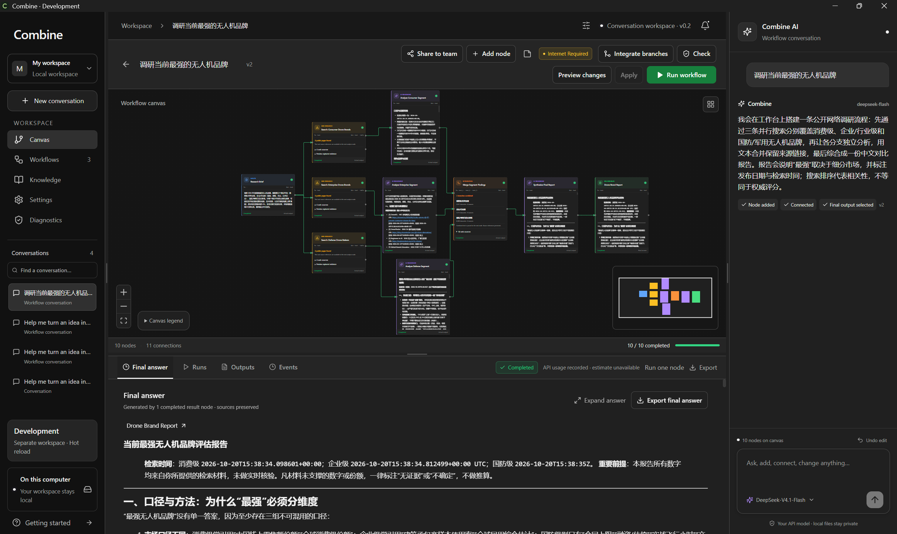
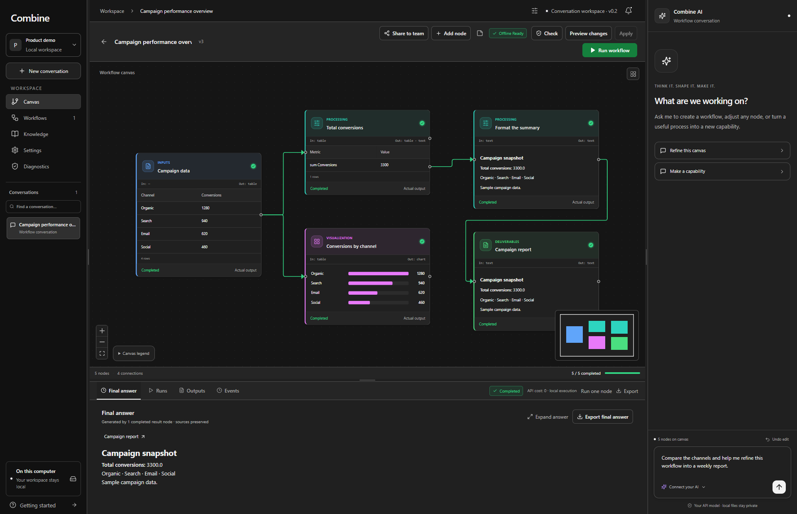
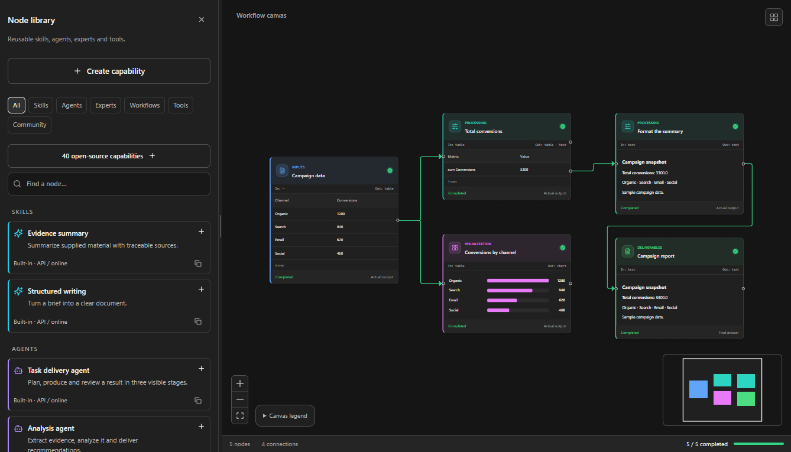
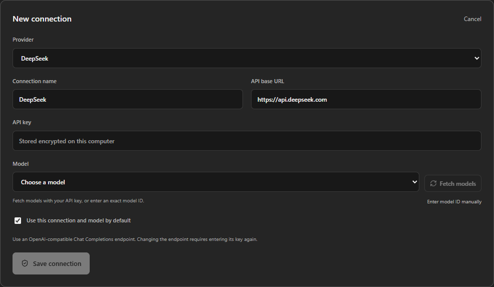

# Combine

**让 AI 工作变得可对话、可编辑、可视化。**

Combine 将你的任务描述转化为节点工作流。通过持续对话或直接编辑画布，连接 AI 模型、调研、数据处理和可复用能力，一步步形成最终成果。

**Make AI work conversational, editable and visual.**

Combine turns task descriptions into node workflows. Refine the flow through conversation or direct canvas edits, connecting AI models, research, data processing and reusable capabilities to produce a final deliverable.



## 功能亮点 / Highlights

| 中文 | English |
| --- | --- |
| **对话驱动编排**：让 AI 创建、连接和修改节点，持续完善工作流。 | **Chat-driven orchestration:** ask AI to create, connect and refine nodes as your task evolves. |
| **可视化执行**：查看节点状态、分支连接，以及画布中的文字、表格、图表、图片和地图。 | **Visual execution:** follow node states and branches, with text, tables, charts, images and maps on the canvas. |
| **自由选择模型**：接入自己的 API Key，选择提供商和具体模型。 | **Your choice of model:** connect your API key and select a provider and model. |
| **可扩展能力库**：使用 Skills、Agents、Experts 和组合节点，复用已有工作流。 | **Extensible capabilities:** reuse skills, agents, experts and composite workflows as nodes. |
| **成果与协作**：汇总最终答案、导出成果，并向团队分享经过确认的工作流模板。 | **Deliver and collaborate:** collect final answers, export results and share reviewed workflow templates with your team. |

另支持本机模型与离线工作流，可按需要使用。 / On-device models and offline workflows are also available when needed.

## 界面预览 / Screenshots

以下为独立演示工作区的真实界面，使用示例数据，不含私人会话或 API 密钥。画布示例中的计算、图表和报告均由实际节点执行生成。

These views use sample data in a clean demo workspace, without personal conversations or API credentials. The calculations, chart and report in the canvas example come from actual node execution.

### 节点画布与最终成果 / Workflow canvas and results

从输入到处理、可视化与交付，在同一画布中查看连接、完成状态和最终结果。

Follow inputs, processing, visualizations and deliverables on one canvas, with visible connections, completion states and final results.



### 可复用能力库 / Reusable capabilities

通过能力库添加工具、技能、智能体和专家节点，或将工作流封装为新的组合能力。

Add tools, skills, agents and expert nodes from the library, or package a workflow into a reusable capability.



### 模型与 API 配置 / Models and API connections

选择模型提供商，配置自己的 API Key，并获取可用模型或手动指定模型 ID。

Choose a provider, add your API key, and fetch available models or enter a specific model ID.



## Run the desktop app

The desktop runtime currently targets **Windows 11 x64**. Building requires Node.js 22+, Python 3.12, uv, a Rust MSVC toolchain, Microsoft C++ Build Tools and the Windows SDK. Installed application users do not need Python or Node.

```powershell
git clone https://github.com/LiMingXin111/Combine.git
cd Combine
powershell -NoProfile -ExecutionPolicy Bypass -File desktop/scripts/build.ps1 -Python312 'C:/path/to/Python312/python.exe'
```

The script installs locked dependencies, bundles Python, checks the local runtime and AppContainer boundary, then builds a Windows installer under `desktop/src-tauri/target/release/bundle/nsis/`. Use `-NoBundle` for an executable-only build. See [desktop setup](desktop/README.md).

After preparing the runtime, double-click `Start-Combine-Dev.cmd` for the development app. UI edits reload through Vite; Python changes publish immutable revisions for new requests. `Stop-Combine-Dev.cmd` stops the managed development session.

Open **Settings → AI connections** to add your own API key, select a provider/model and test the connection. No credentials are bundled. A model connection test and API workflow execution can incur charges from your provider. Local workflows without network nodes run offline after their required resources are prepared.

## Optional account and team service

The desktop app works without an account. To create or join teams on this computer:

```powershell
python -m venv .venv
.venv/Scripts/python.exe -m pip install -r requirements-lock.txt
./Start-Combine-Team-Server.cmd
```

The service listens at `http://127.0.0.1:8765`. In the desktop space selector, choose **Create team** or **Join team**, use that server URL and register/sign in. For different computers, host the service behind HTTPS. See [team spaces](docs/TEAM_SPACES.md) and [self-hosting](deploy/README.md).

The repository also contains the separate browser/server compatibility application. `run.bat` or `./run.sh` starts it on loopback. Without real model settings it can use a clearly identified deterministic demo; this is not a real model answer. Its server-side data model differs from the desktop's private local workspace.

## Privacy and repository contents

Private desktop attachments, knowledge, local references and derived material stay on the device. Only public prompts you choose to send use a configured API. Team sharing uploads a reviewed, sanitized workflow definition; downloaded copies are independent and never auto-run.

This repository contains application source, dependency locks, automated synthetic contract tests, build/start scripts, reviewed product screenshots, and required public third-party assets/licenses. It does not include API keys, user workspaces/databases, unapproved personal conversations or captures, private documents, model weights, build tools or generated installers. Downloaded model/runtime resources have their own licenses.

## Checks

```powershell
cd desktop
npm ci
npm run build
python -m unittest discover -s tests -p 'test_*.py' -v
```

For backend regression, install the root locked requirements and run `python scripts/check.py` from the repository root. The automated tests use temporary data and intercepted model transports; they are not model-quality benchmarks. Native filesystem isolation and credential protection require Windows.

## Status and license

Combine is a development preview. Windows is the validated desktop target; macOS/Linux desktop support, arbitrary plugin execution, real-time multi-user editing, every Office variant and formal updater/rollback are not complete. Complex document layouts and CPU-model performance vary by file and device.

Combine's original code is [MIT licensed](LICENSE). Vendored libraries and public capability references retain their original terms and notices; see [third-party notices](THIRD_PARTY_NOTICES.md).
